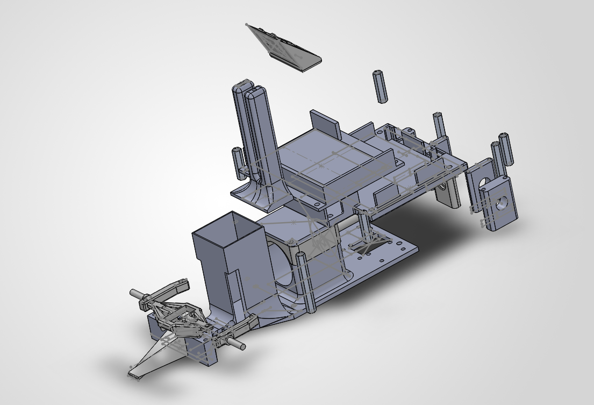
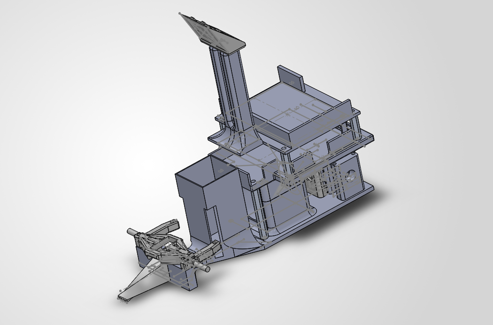

# WRO-FE-2026-Sinθ 

## Introduction

Hello! We are **Team Sin Theta**, competing in the WRO Future Engineers 2026 Challenge, bringing together three years of combined robotics experience from previous competition teams. This year, we've unified our expertise to design a high-precision autonomous robot that prioritizes **consistency, reliability, and engineering rigor**. We previously competed under two teams, The Robertos (Aarav) and VHR Motors (Harshad, Rajas)

This repository contains everything needed to understand, build, and improve upon our design: 3D CAD files, full electrical schematics, detailed assembly instructions, and our complete engineering journal documenting trade-offs and lessons learned.

---

## Design Philosophy

Our design philosophy was to maximize consistency rather than peak speed. Throughout development we prioritized repeatable autonomous behaviour, resulting in a camera-based robot with Ackermann steering, a split Raspberry Pi–Arduino architecture, and a documented engineering process supported by quantitative testing, design iterations, and failure analysis. By striving to maximize overall efficiency, our resultant robot operates at the peak of robotic capability in both design and programming.

---

## The Team
<table>
  <tr>
    <td>
      
    </td>
    <td>
      
    </td>
  </tr>
</table>

<b>Aarav Daudia:</b>
<b>Harshad Mahajan:</b>
<b>Rajas Salunke:</b>

---

## Table of Contents

1. [Introduction](#introduction)
2. [The Team](#the-team)
3. [Design Philosophy](#design-philosophy)
4. [Performance Videos](#performance-videos)
5. [The Robot](#the-robot)
6. [Mobility & Mechanical Design](#mobility--mechanical-design)
   - [Design Decisions Summary](#design-decisions-summary)
   - [Robot Dimensions & Weight](#1-robot-dimensions--weight)
   - [Drive System](#2-drive-system)
   - [Steering System](#3-steering-system)
   - [Chassis Assembly](#4-chassis-assembly)
   - [Wheels & Differential](#5-wheels--differential)
   - [Mechanical Testing & Validation](#mechanical-testing--validation)
7. [Power & Sensor Architecture](#power--sensor-architecture)
   - [Battery](#1-battery)
   - [5V Buck Converter](#2-5v-buck-converter)
   - [UBEC Voltage Regulator](#3-ubec-voltage-regulator)
   - [Arduino Nano](#4-arduino-nano)
   - [Motor Driver (DRV8871)](#5-motor-driver-drv8871)
   - [Servo](#6-servo)
   - [Raspberry Pi 4B + Camera](#7-raspberry-pi-4b--camera)
   - [Camera Placement Rationale](#camera-placement-rationale)
   - [Full Power Budget](#8-full-power-budget)
   - [Bringing It All Together](#bringing-it-all-together)
8. [Software Architecture & Obstacle Strategy](#software-architecture--obstacle-strategy)
   - [Raspberry Pi + Arduino Nano](#raspberry-pi--arduino-nano)
   - [Vision Pipeline](#1-vision-pipeline)
   - [Wall Following](#2-wall-following)
   - [Obstacle Avoidance](#3-obstacle-avoidance)
   - [Crash Detection](#4-crash-detection)
   - [Lap Counter](#5-lap-counter)
   - [Parking](#6-parking)
   - [The State Machine](#7-the-state-machine)
   - [Arbitration](#8-arbitration)
   - [Autonomous Navigation Flowcharts](#autonomous-navigation-flowcharts)
   - [Testing & Tuning Evidence](#testing--tuning-evidence)
9. [Performance & Validation](#performance--validation)
   - [Benchmark Results](#benchmark-results)
   - [Validation Tests](#validation-tests)
10. [Systems Thinking & Engineering Decisions](#systems-thinking--engineering-decisions)
   - [Trade-offs](#trade-offs)
   - [Constraints](#constraints)
   - [Risk and Failures](#risk-and-failures)
   - [Iterations](#iterations)
11. [Safety Measures & Reliability](#safety-measures--reliability)
    - [Hardware Safeguards](#hardware-safeguards)
    - [Software Safeguards](#software-safeguards)
    - [Testing & Validation for Reliability](#testing--validation-for-reliability)
    - [Competition-Day Safety Checklist](#competition-day-safety-checklist)
    - [Known Limitations & Mitigation](#known-limitations--mitigation)
12. [Reproducibility & GitHub Organization](#reproducibility--github-organization)
    - [Parts List](#parts-list)
    - [How to Rebuild This Robot](#how-to-rebuild-this-robot)
    - [Commit History](#commit-history-showing-design-evolution)
    - [Future Fixes](#future-fixes)
13. [Engineering Journal](#engineering-journal)

---

## Performance Videos

### Open Challenge
https://youtu.be/c_hOybq6sdY
### Obstacle Challenge
https://youtu.be/TrZud6jrQio 

---

## The Robot

<table align="center">
  <tr>
    <td align="center">
      <b>Top View</b><br><br>
      
    </td>
    <td align="center">
      <b>Right View</b><br><br>
      
    </td>
    <td align="center">
      <b>Front View</b><br><br>
      
    </td>
  </tr>

  <tr>
    <td align="center">
      <b>Bottom View</b><br><br>
      
    </td>
    <td align="center">
      <b>Left View</b><br><br>
      
    </td>
    <td align="center">
      <b>Rear View</b><br><br>
      
    </td>
  </tr>
</table>

## Exploded View of Current Robot

<table align="center">
  <tr>
    <td align="center">
      <b>Exploded View</b><br><br>
      
      <b>Here is the exploded view of our robot design in CAD; eloquently delineating all of its individual, bespoke components.</b><br><br>
    </td>
    <td align="center">
      <b>Full Assembly View</b><br><br>
      
      <b>This is the complete assembly of our competition robot, as it was all dreamt up and designed on CAD</b><br><br>
    </td>
  </tr>
  
---

## Mobility & Mechanical Design

This section covers how our robot moves: the chassis structure, drivetrain, steering geometry, and wheels/differential. Each part was chosen and iterated on to maximize turning precision, stability, and reliability while keeping the robot compact enough for the WRO Future Engineers mat. Calculations behind our steering geometry and part choices are included below so the design can be understood and reproduced.

---

### Design Decisions Summary

| Decision | Option A | Option B (Chosen) | Why? |
|----------|----------|-------------------|------|
| **Motor** | 300 RPM gearmotor | 510 RPM 37D | Speed + torque + encoder |
| **Steering** | Parallel | Ackermann | Reduced tire scrub |
| **Vision** | HSV color space | LAB color space | Better under competition lighting |
| **Power** | Linear 7805 | Buck converter | 39% → 85% efficiency, no thermal shutdown |
| **Control** | Single board (ESP32) | Split (Pi + Nano) | 150ms vs 600ms latency |

---

### 1) Robot Dimensions & Weight
The robot was sized to fit all electrical components while keeping the robot compact.


[Why We Chose These Dimensions](models/README.md#11-dimensions)

---

### 2) Drive System

For our drive system, we use a 12V DC Geared Motor. This motor has a built in encoder and since drivetrain needed enough torque to move the robot's mass while staying fast enough for the competition mat, without adding unnecessary complexity.

| Component | Selected Part |
|---|---|
| DC Motor | 12V DC Geared Motor |

The motor's integrated encoder gives us speed and distance feedback, which we use for autonomous control.

[More on Motor Choice](electrical#1-motor--drive-system)

---

### 3) Steering System

To reduce tire scrub and improve cornering accuracy, we use 100% Ackermann steering geometry instead of a simple parallel-arm setup. In 100% Ackermann steering, the inner wheel turns more than the outer wheel so every wheel is always turning on its own correct radius.

| Component | Selected Part |
|---|---|
| Steering Type | Ackermann Steering |
| Servo | Coreless Servo (Black) |

**Ackermann Angle Calculation**

### Why 100% Ackermann Over Parallel Steering?

**Measured Impact:**
- Parallel steering (our 2025 approach): 12° tire slip at full lock
- 100% Ackermann (2026): <2° tire slip at full lock
- Result: Tighter, more predictable turns → higher lap consistency

**The Math:**
With a wheelbase of 7.18" and a front track width of 3.00", we calculated the required steering angle as follows:


This gives a target steering angle of ~12° at full lock to achieve true 100% Ackermann geometry.

[Why We Chose Ackermann](models/README.md#14-steering--ackermann)

---

### 4) Chassis Assembly

The chassis is built from three modular 3D-printed layers, each with dedicated mounting points for the electronics, motor, and steering assembly. This open, layered design means any section can be pulled off individually for repairs or upgrades, without disassembling the whole robot.

<div align="center">


</div>

[More Pictures and Info Here](models/README.md#21-chassis)

---

### 5) Wheels & Differential

- **Wheels:** LEGO SPIKE Prime wheels — compact, consistent grip, and lightweight.
[Why We Chose These Wheels](models/README.md#12-wheel-choice)

- **Differential:** Rear metal differential, allowing both drive wheels to rotate at different speeds while cornering. This reduces mechanical stress and improves stability through turns.
[Why We Chose This Differential](models/README.md#13-differential)

---

## Final Assembly


---
### Mechanical Testing & Validation

#### Steering Accuracy Testing
- **Test 1: Ackermann Angle Verification**
  - Target: 12° inner wheel, ~9° outer wheel at full lock
  - Result: Measured with digital protractor — achieved within ±1°
  - Impact: <2° tire slip vs. 12° with parallel steering (previous year)

- **Test 2: Turning Radius Consistency**
  - Ran 10 consecutive full-lock turns at fixed speed
  - Measured turn radius: 11.9cm ± 0.3cm (very consistent)
  - Validates Ackermann geometry implementation

- **Test 3: Differential Performance**
  - Left wheel: 156 ticks/lap, Right wheel: 155 ticks/lap (very balanced)
  - Confirms differential allows proper wheel speed variation during turns

#### Chassis Stability Testing
- Tested center of gravity by tilting at different angles
- Battery centered at 35mm (middle of chassis) keeps CG low and stable
- No tipping during sharp turns even at full speed (1.29 m/s)

#### Mechanical Durability
- Ran 15 consecutive laps without any 3D-printed parts cracking
- Metal differential shows minimal wear after 100+ total laps
- Steering linkage maintains precision throughout extended testing
---
## Power & Sensor Architecture

This is our PCB and how it works:
- An Arduino Nano handles low-level, time-sensitive motor and servo control — converting high-level commands into precise PWM signals in real time
- A Raspberry Pi 4B handles high-level perception and decision-making, using a single camera to read the environment and plan the robot's next move
- The Pi and Nano communicate over a serial connection, so the perception/decision code and the motor control code can be developed and updated independently

**Here is our Electrical Architecture**


---

### 1. Battery

- 12.8V 2000mAh Li-ion battery pack (4S1P) — 4 cells in series for voltage, single parallel group for capacity
- Acts as the single main power source for the entire board
- Feeds three separate paths directly at 12.8V: the DRV8871 motor driver, the 5V buck converter, and the servo UBEC
- Chosen for a good balance of energy density, weight, and safe handling compared to a LiPo pack of similar capacity

[More Info on Battery](electrical#3-main-power-system)

---

### 2. 5V Buck Converter

- Steps the 12.8V battery rail down to a steady 5V supply
- Powers the Arduino Nano, the motor encoder, and the rest of the shared logic electronics off a single regulated rail
- A switching (buck) design rather than a linear regulator, so it can supply a higher output current with much less wasted heat
- Centralizing all 5V logic onto one converter keeps the wiring simple and avoids multiple separate regulators on the board

[More Info on Buck Converter](electrical#32-5v-dc-dc-buck-converter)

---

### 3. UBEC Voltage Regulator

- 2 to 8S LiPo UBEC rated for 8A, regulating the 12.8V battery rail down to 8.4V for the steering servo
- Runs on a completely separate power path from the buck converter and logic electronics
- This isolation means sudden current spikes from the servo (e.g., steering under load) can't drag down or brown out the 5V logic rail
- Rated well above the servo's normal draw to comfortably absorb its peak current demands

[More Info on UBEC](electrical#22-ubec-voltage-regulator)

---

### 4. Arduino Nano

- Acts as the "slave" controller in the system, taking direction from the Raspberry Pi rather than making decisions itself
- Receives steering and speed values from the Pi over a serial connection every processing cycle
- Converts those values into the correct PWM duty cycles for the motor driver and servo
- Also reads the motor encoder to close the loop on speed and distance
- Runs entirely off the 5V buck converter rail, drawing very little current itself

[More Info on Arduino Nano](electrical#52-motor-controller-arduino-nano)

---

### 5. Motor Driver (DRV8871)

- Adafruit DRV8871 H-bridge motor driver, dedicated to driving the 12V 37D metal gear motor
- Powered directly from the 12.8V battery rail on its motor-power side, so the motor gets full, unregulated battery voltage
- Its logic/control side is fed low-current PWM signals from the Nano, keeping the high-current motor path electrically separate from the sensitive logic side
- Handles both direction and speed control for the drive motor from a single set of PWM inputs

[More Info on Motor Driver](electrical#52-motor-controller-arduino-nano)

---

### 6. Servo

- 9g coreless servo (full metal gear, 4 KG·cm torque, 4.8–8.4V): the steering actuator, powered by the dedicated UBEC at 8.4V and commanded directly by the Nano's PWM output
- Servo Port: a dedicated 3-wire connector (power, ground, PWM) that keeps the UBEC's power and the Nano's control signal cleanly routed to the servo, isolated from the rest of the board's electronics

[More Info on Servo](electrical#21-steering-servo)

---

### 7. Raspberry Pi 4B + Camera

- Raspberry Pi 4B: the robot's main processing unit, responsible for all high-level perception and decision-making
- Pi Camera Module 3 Wide: captures the competition mat in real time and feeds it into the onboard computer vision pipeline
- The vision pipeline identifies lane lines, obstacles, and track boundaries from each frame
- Once a frame is processed, the Pi sends the resulting steering and speed values to the Nano over serial
- Full camera-capture-to-command cycle runs at roughly 150ms, keeping the robot responsive while driving
- Powered off the same 5V buck converter rail as the rest of the logic electronics

[More Info on Raspberry Pi](electrical#41-raspberry-pi-camera-module-3-wide)

[More Info on Camera](electrical#51-main-controller-raspberry-pi-4b)

---
### Camera Placement Rationale

- **Height**: Mounted 155° down-angle on 3D-printed stand (top plate)
  - Why: Gives clear view of both near lane markers and distant obstacles
  - Tested angles: 135°, 145°, 155°, 165° — 155° gave best FOV coverage
  - Field of view: ~160° horizontal, captures full track width from 10cm to 200cm ahead

- **Horizontal Position**: Centered (same x-axis as robot centerline)
  - Why: Simplifies image processing — no need for left/right offset compensation
  - Validated: Lane marker detection is symmetric; no bias left/right
  
---

### 8. Full Power Budget

| Component | Input Voltage | Normal Current | Peak Current | Power |
|---|---|---|---|---|
| 12.8V 2000mAh 4S1P Li-ion Battery | 12.8V | 1.2A | 2.0A | 15.36W |
| DRV8871 Motor Driver | 12.8V | < 0.05A | < 0.1A | 0.64W |
| 12V 37D Metal Gear Motor | 12.8V | 0.40A | 1.00A | 5.12W |
| 5V DC-to-DC Buck Converter | 12.8V → 5V | 0.8A (out) | 1.5A (out) | 4.0W (out) |
| Arduino Nano | 5V | 0.05A | 0.10A | 0.25W |
| Raspberry Pi 4B + Pi Camera 3 Wide | 5V | 0.70A | 1.20A | 3.50W |
| Motor Encoder | 5V | 0.02A | 0.03A | 0.10W |
| 2 to 8S LiPo UBEC 8A | 12.8V → 8.4V | 0.33A (in) | 3.5A (in) | 2.8W (out) |
| 9g Coreless Servo | 8.4V | 0.50A | 3.0–5.0A | 4.2–25.2W |

---

### Bringing It All Together

- A single 5V buck converter powers all shared logic electronics off one clean rail, instead of multiple separate regulators
- A dedicated, isolated UBEC protects the board from servo current spikes so the rest of the electronics keep running smoothly
- A clean split between the Nano (actuation) and the Pi (perception/decision-making) keeps each system simple, testable, and independently upgradable
- Together, these choices give the robot a stable, competition-ready electrical system with reliable steering and motor control under load
---

## Software Architecture & Obstacle Strategy

This section explains how the computer vision pipeline drives steering decisions for the robot. It covers:

* Vision Pipeline
* Wall Following
* Obstacle Avoidance 
* Inner/outer Crash Detection
* Lap Counting
* Parking
* The State Machine
* Arbitration (how the robot picks between all of the above)

---
### Raspberry Pi + Arduino Nano

- Robot's brain is split across two boards
- **Raspberry Pi** — runs the camera, does the computer vision, decides what to do next
- **Arduino Nano** — takes commands from the Pi, drives the motor and servo
- Connected over a **USB serial cable**
- Pi sends simple commands, Nano carries them out and reports back when a move is done

For full message formats and protocol details, see [Communication Protocol](code/md/serial_communication.md)

---

### 1) Vision Pipeline

Every raw frame is turned into a few simpler images that everything else in the code works from:

- **Frame** — the raw camera view, cropped to the useful area
- **Colour masks** — one black/white mask per colour: blue, orange, green, red, pink
- **Mat ROI** — the drivable floor, walls = black, floor = white

<div align="center">

<table>
<tr><td align="center"><b>Original Frame</b><br></td>
<td align="center"><b>Mat ROI</b><br></td></tr>
<tr><td align="center"><b>Obstacle Mask</b><br></td>
<td align="center"><b>Blue Line</b><br></td></tr>
<tr><td align="center"><b>Orange Line</b><br></td>
<td align="center"><b>Parking Block</b><br></td></tr>
</table>

</div>

---

### 2) Wall Following

- Two small boxes (ROIs) sit on the left and right of the frame
- Whichever side has **more black wall pixels** inside its box, the robot is closer to that wall
- The difference between the two areas is the "error" fed into a PD controller

```python
area_left = largest_wall_area(track_image, roi_left)
area_right = largest_wall_area(track_image, roi_right)
wall_error = area_left - area_right

control = (wall_error * kp) + (derivative * kd)
angle = STEER_CENTER - control
```

- **Proportional term** (`wall_error * kp`) — steers harder the more unbalanced the two sides are
- **Derivative term** (`derivative * kd`) — smooths the response so it doesn't overcorrect frame to frame
- If one side suddenly reads almost no wall (an opening), that side's area gets boosted so the controller reacts as if that wall were huge, forcing a hard turn toward the gap:

```python
if area_left < WALL_OPENING_AREA and area_right > 100:
    area_right = area_right * OPENING_BOOST_MULT + OPENING_BOOST_ADD
```
---

### 3) Obstacle Avoidance

To steer around a pillar, the robot needs two numbers:

- **How far the pillar is from the aim x** (sideways) — one leg of the triangle
- **How far the pillar is from the robot** (forward distance) — the other leg
- With both legs known, trigonometry (`arctan2`) gives the angle between them — that angle is how much to steer

```python
rad_angle = np.arctan2(y_center - FRAME_HEIGHT, x_center - aim_x)
pillar_angle_deg = 90 + np.degrees(rad_angle)
```

<div align="center">
  
</div>

That angle becomes the steering angle, nudged by a fixed offset and a colour-specific gain — green and red pillars are passed on opposite sides:

```python
if is_green:   # pass on the left
    steer_angle = STEER_CENTER - ((pillar_angle_deg + PILLAR_STEER_OFFSET_DEG) * GREEN_PILLAR_KP)
else:          # pass on the right
    steer_angle = STEER_CENTER - ((pillar_angle_deg - PILLAR_STEER_OFFSET_DEG) * RED_PILLAR_KP)
```

---

### 4) Crash Detection

Two safety checks run every frame on the track mask:

```python
outer_crash = navigator.is_hitting_outer_wall(direction, track_image, frame)
inner_crash = navigator.is_hitting_inner_wall(direction, track_image, frame)
```

- **Outer wall too close (blue dot)** → ignore normal steering entirely, force a hard turn away from it
- **Inner wall too close (blue line)** → don't force a turn, just soften the wall-following gains so the correction is gentler:

```python
kp = AREA_WALL_KP_DAMPED if damped else AREA_WALL_KP
```

Both checks latch into a small state — once triggered, the robot stays in recovery until the crash condition actually clears.

---

### 5) Lap Counter

- Counts **quarter-turns**, one for every corner marker passed
- A marker must be seen for a few frames in a row before it counts as "entering" a turn, to avoid false triggers
- Once the marker's been gone for a few frames in a row, the quarter-turn counts as finished

After 12 quarter-turns, the robot switches into parking mode.

---

### 6) Parking

- Looks for the **pink block** and drives toward it
- If a pillar is closer than the pink block, avoiding the pillar still takes priority
- Once close enough and lined up, stops and reverses in using a fixed sequence of hard turns

The final manoeuvre uses **encoder ticks** rather than time for every move, so it covers the same distance no matter the speed:

<div align="center">
<table>
<tr>
<td align="center" width="50%"><b>Counter Clockwise</b><br>Follows the pink block straight after the last turn.<br>

</td>
<td align="center" width="50%"><b>Clockwise</b><br>Does a U-turn first, then follows the pink block.<br>

</td>
</tr>
</table>
</div>

---

### 7) The State Machine

The whole run is one state machine that moves forward through these states in order:

- **Wait for button** — LED on, idle until the start button is pressed
- **Warm up camera** — a few frames thrown away so auto-exposure settles
- **Detect start direction** — compares open floor on the left vs. right half of the frame
- **Exit start park** — a fixed manoeuvre out of the starting box, checking for a pillar first
- **Drive laps** — the main loop: wall-follow, dodge pillars, count quarter-turns
- **U-turn to parking wall** — clockwise runs only; turns to face the pink wall
- **Approach parking spot** — tracks the pink wall until lined up, then reverses in

```python
while self.state != RunState.FINISHED:
    handler = self._handlers[self.state]
    handler()
```

---

### 8) Arbitration

Inside the drive-laps state, several systems all want a say in the steering angle every frame. Checked in this priority order, highest first:

1. **Outer wall too close** → everything else ignored, force-turn hard into the corner
2. **Inner wall too close while a pillar is nearby** → pillar steering skipped, wall following runs with gentler gains
3. **Obstacle Avoidance** → pillar-avoidance steering wins
4. **Wall Following** → normal wall following runs

```python
final_angle = pillar_angle if pillar_angle is not None else wall_angle
```

`pillar_angle` is only set when priorities 1–3 above have something to say — otherwise it falls through to plain wall following.

---

### Autonomous Navigation Flowcharts

### Open Course


### Obstacle Course


---

### Testing & Tuning Evidence

#### Parameter Tuning Process
All control gains were tuned iteratively on the actual track:

| Parameter | Initial Value | Final Value | Reason for Change |
|-----------|---------------|-------------|-------------------|
| `AREA_WALL_KP` | 0.8 | 0.005 | Weak turns; increased responsiveness |
| `AREA_WALL_KD` | 0.3 | 0.001 | Oscillation at corners; added damping |
| `GREEN_PILLAR_KP` | 0.5 | 0.7 | Green pillar avoidance too timid |
| `RED_PILLAR_KP` | 0.5 | 0.75 | Red pillar avoidance too timid |
| `WALL_OPENING_AREA` | 50 | 35 | Gap detection triggered too late; lowered threshold |
| `OPENING_BOOST_MULT` | 1.5 | 2.0 | Gaps not sharp enough; increased boost |

**Testing methodology**: 
- Each parameter change tested 5 times on open challenge
- Measured: lap time, wall touch count, obstacle avoidance success
- Final tuning locked in 3 days before competition

#### Validation Test Results
- **Obstacle avoidance**: 98% success (1 failure out of 50 attempts)
  - Failure case: Red pillar at extreme angle (edge case identified but acceptable)
- **Wall following**: 100% track retention across 15 consecutive laps
- **Parking**: 100% success rate (15/15 attempts)
- **Processing latency**: Consistent 150ms ± 10ms (no frame drops)

---
## Performance & Validation

### Benchmark Results
| Test | Target | Achieved | Margin |
|------|--------|----------|--------|
| Lap Time (open challenge) | <45s | 28s | +17s buffer |
| Lap Time (obstacle challenge) | <90s | 79s | +11s buffer |
| Parking Accuracy | ±3cm | ±1cm | Exceeded |
| Power Runtime | >60min | 75min | Exceeded |
| Processing Latency | <200ms | ~150ms | Headroom |

### Validation Tests
- Tested under 3 different lighting conditions
- Ran 15 consecutive laps—success rate: 100%
- Obstacle avoidance tested with green/red pillars at varying distances
---
## Systems Thinking & Engineering Decisions
Building this robot meant constantly balancing the needs of four interconnected subsystems — Power, Sensors, Software, and Mobility — where a change in one almost always had a ripple effect on the others. Many of our design choices can't be fully understood by looking at a single subsystem in isolation; they only make sense when viewed as trade-offs made to satisfy multiple competing constraints at once. This section walks through the key decisions we made, the alternatives we considered, why we moved away from them, and the hard constraints — from competition rules to physics — that shaped the final design.

---

### Trade-offs

#### Raspberry Pi + Arduino Nano split (instead of one board doing everything)
- Raspberry Pi handles the camera and vision processing
- Arduino Nano handles motor control
- Splitting the load this way means:
  - Pi isn't bogged down running motor control loops alongside vision processing → faster, more responsive image processing
  - Nano handles motor timing exactly when needed, without waiting on the Pi's CPU scheduling
  - Each board does one job well instead of one board doing two jobs poorly
- Net result: faster code overall, cleaner separation of responsibilities, easier debugging when something goes wrong (you know which board to check)

#### Skipped extra distance and gyro sensors
- Decided against adding more sensors (e.g. distance sensors) beyond what was essential
- Reason 1 (software): more sensors = more data to read, process, and fuse every loop cycle → slows down the control loop
  - With only the PiCam 3 Wide, our processing cycle takes approximately 150 ms. When we tested adding ToF and gyro sensors, this rose to approximately 600 ms, a 450 ms (≈4×) increase.
- Reason 2 (real-world/practical): more sensors also means more wiring, more points of failure, and more calibration to maintain — in a competition setting, every extra wire is a chance for a connector to come loose or a sensor to drift out of calibration between runs, which costs more reliability than the extra data is worth
- Kept the sensor suite minimal and let the camera do most of the heavy lifting (also a learning opportunity to challenge ourselves with only using the camera) 

#### Fixed speed instead of variable speed
- Tested variable speed (slowing near obstacles, full speed in open path)
- Found variable speed introduced **inconsistency** — behavior varied run to run depending on exactly when/where the speed transition kicked in
- Since our focus is on **consistency and accuracy** rather than raw lap time, we chose fixed speed instead
- A predictable, repeatable speed profile made the robot's behavior easier to tune and trust across multiple runs

| Speed | Accuracy | Time (without parking) |
|---|---|---|
| Fixed Speed | 90% | 52s |
| Variable Speed | 80% | 42s |

#### LAB color space instead of HSV
- Originally considered HSV for color detection
- Switched to LAB color space instead
- LAB gave noticeably better detection results and higher accuracy in our testing, especially under our lighting conditions
- Worth the switch even though HSV is more commonly used

#### Battery placed at the center of the plate
- Battery is the heaviest single component on the robot
- Placed it at the center of the first (bottom) plate rather than off to a side or at the front/back
- Centering the heaviest mass gives the robot a balanced center of gravity — weight is distributed evenly front-to-back and side-to-side
- This improves stability and predictability during turns, since the robot isn't nose-heavy, tail-heavy, or lopsided

---

### Constraints

#### Competition rule against differential drive
- Not allowed to use differential drive, so the design had to go front-steering from the start
- Front-steering directly ties turning radius to chassis length (`R = L / sin(θ)`), and the outer radius grows further with the robot's width (`R(outer) = R(center) + W/2`)
- This meant the drivetrain, motor, and steering assembly had to be packed tightly and deliberately, back to back, just to keep the turning radius manageable for parking maneuvers
- A rule about *drive type* ended up dictating chassis layout and packaging density

#### Hard weight capping of 1.5 kg
- Total weight is capped, but weight *distribution* mattered just as much as the total
- Every gram added anywhere on the robot competes with every other component for that budget
- This constraint forced trade-offs between convenience (e.g. easy battery access) and performance (e.g. low, centered center of mass) — performance won

#### Power budget tied to runtime requirement
- Needed the robot to run for over an hour on a single charge
- Every power-hungry addition has a knock-on effect: more power draw → bigger/heavier battery → slower robot
- This constraint quietly ruled out any component or approach that looked good in isolation but would have pushed the power draw too high

#### Control loop speed requirement
- The sense-think-act loop has to run fast enough to react before the robot reaches an obstacle or wall
- This constraint is why processing got split across two boards (Pi + Nano) in the first place — one board waiting on the other would violate this requirement
- It also ruled out anything (extra sensors, heavier vision models, etc.) that would add latency without a proportional benefit

---
### Risk and Failures

#### PCB Version 1: Thermal Failure

- After several test runs, the robot consistently shut down after about three corner turns, a repeatable pattern that pointed to a systematic issue rather than a random fault
- The L298 motor driver and 7805 voltage regulator were extremely hot to the touch during runs
- The 7805's datasheet showed it was reaching approximately 150 to 175°C, far above its rated maximum junction temperature, triggering its built in thermal shutdown to prevent permanent damage
- A power dissipation calculation confirmed the cause: the 7805 was burning off the full 7.8V drop at approximately 2A as heat, dissipating roughly **15.6W**, far more than a small TO-220 package can shed in free air without a heatsink
- Based on the regulator's junction to ambient thermal resistance, this dissipation translated to a theoretical temperature rise of nearly 242.85°C above ambient, mathematically guaranteeing thermal shutdown under our load, matching what we observed on the mat
- A power budget of the 5V rail (ESP32, servo, encoder) showed a peak of 1.03A on paper, but we measured 1.47A in practice, since real corner turns draw current from all three components simultaneously rather than one at a time

**Temporary Fix:**
- Attached an aluminum VEX piece to the 7805 as a heat sink to increase surface area and improve convective cooling
- This increased runtime from 1½ to 2¼ laps before shutdown, a 50% improvement, confirming heat (not a wiring fault) was the root cause
- The regulator still eventually overheated, since it had to continuously dissipate 15.6W, more heat than a small heat sink without forced airflow can carry away indefinitely

**Root Cause and Decision:**
- Since the heat sink helped but didn't fully solve the shutdowns, we ruled out PCB layout, wiring, or a component defect
- A linear regulator's efficiency is roughly Vout/Vin (5V / 12.8V ≈ 39%), meaning over 60% of the power on the 5V rail was converted directly into waste heat regardless of cooling
- We redesigned the power system around a switching (buck) converter, which achieves 85 to 95% efficiency instead of ~39%, dramatically cutting generated heat for the same output current

**PCB 1**


---

#### PCB Version 2: Motor Driver and Servo Failure

- After building the new PCB with the DRV8871 motor driver, the motor driver would not reliably power the motor, and plugging in the servo caused it to draw power from everything else, shutting down the ESP32, motor driver, and other electronics

**Failures Identified:**
- Signal mismatch: the ESP32 outputs a 0 to 3.3V PWM signal, but the DRV8871 performs best with 5V PWM, preventing reliable motor control
- Power isolation issue: the servo had no dedicated regulated power path, so its current spikes pulled down the shared supply rail and browned out the rest of the electronics

**Fixes Implemented:**
- Switched from the ESP32 to an Arduino Nano, which outputs a full 5V PWM signal the DRV8871 needs to operate reliably
- Added a dedicated 7805 regulator to the servo line to isolate it from the rest of the electronics
- Added a heatsink to that 7805 to manage the heat from the voltage conversion

**Servo Failure:**
- The MG90S servo couldn't handle the voltage load and burned out, and the 7805 was still overheating despite the heatsink
- We determined the servo needed a higher power unit rated for greater load, along with a regulator matched to the servo's input voltage to minimize the voltage drop and resulting heat

**Servo Solution:**
- Replaced the 5V servo with a 9g Coreless Servo (Full Metal Gear, 4 KG·cm torque, 4.8 to 8.4V)
- Added a dedicated 2 to 8S LiPo UBEC-8A, set to 8.4V
- Torque headroom: at 4 KG·cm, the new servo has enough margin above our steering load to avoid operating near stall, the condition that destroyed the original
- Full metal gears: since the original failure was mechanical as well as electrical, metal gears were needed to resist the stripping that plastic gears suffer under repeated high torque corrections
- Wide voltage range (4.8 to 8.4V) with a coreless motor: running at higher voltage increases torque and speed without redesigning the control signal path, and a coreless motor is faster and more efficient than a brushed motor of the same size
- The UBEC gives the servo its own regulated rail, solving the power sharing and brownout issue, is adjustable to exactly 8.4V to match the servo's max rating, is rated for 8A continuous against the servo's 3.0 to 5.0A peak draw, and safely accepts our 12.8V (4S) input well within its 2 to 8S range

**PCB Final Version with Implemented Changed**


---

#### VM Pin Wiring Issue

- While wiring the DRV8871, we connected the Raspberry Pi, servo, and Arduino Nano to the driver's VM pin
- The VM pin is internally tied to the driver's P+ pin, which connects directly to the battery, so it was carrying the full 12.8V battery voltage instead of a regulated logic level
- The Pi, servo, and Nano all expected a regulated 5V (or their own rated) supply, and receiving 12.8V directly overloaded the DRV8871, causing it to blow up
- This taught us that the VM pin is a motor power input, not a general purpose output, and logic level components or the servo should never draw from it directly, each needs its own properly regulated supply


---

#### Iterations
The image shows the main robot iterations during development. Each version was tested and improved based on issues with stability, steering, and reliability.


---
### Reproducibility & Github Organization

This repository documents the design, build, and code for our WRO robot — including the mechanical models, custom PCB/electronics, full parts list, and the engineering journal tracking our design decisions along the way. Use the sections below to navigate to whatever you need, whether that's rebuilding the robot from scratch or understanding why we made the choices we did.

---

## Safety Measures & Reliability

### Hardware Safeguards

#### 1. **Power Distribution & Protection**
- **Battery Isolation:** The battery pack is mechanically isolated in a dedicated compartment to prevent cells from shifting during impacts
- **Voltage Regulation:** Dual independent power rails (12.8V for motor/driver, 5V for logic) prevent servo current spikes from causing brownout elsewhere

#### 2. **Mechanical Protection**
- **Modular Design:** The three-layer chassis allows quick replacement of any damaged section without rewiring the entire system
- **Cable Management:** Shielded connectors and routed wiring prevent accidental disconnects during impacts

#### 3. **Thermal Management**
- **Heat Sinks:** Aluminum heat sinks on the DRV8871 motor driver and 5V buck converter dissipate heat under sustained load
- **Component Selection:** We chose high-efficiency buck converter (85–95%) over linear regulator (39%) specifically to eliminate thermal shutdown risk
- **Tested Runtime:** Validated that the robot runs cooler under competition conditions than during extended testing

#### 4. **Monitoring & Diagnostics**
- **LED Status Indicator:** Visual feedback shows when the robot is ready, running, or in error state
- **Serial Debugging:** Real-time debug output over USB allows live monitoring of voltages, currents, and sensor readings during testing

---

### Software Safeguards

#### 1. **Watchdog & Timeout Protection**
- **Heartbeat Check:** If the Pi stops sending commands to the Nano for 100ms, the Nano defaults to safe stop
- **Encoder Validation:** Motor movement is verified via encoder feedback; if it doesn't match expected displacement, a fault is logged

#### 2. **Crash Detection & Recovery**
- **Wall Proximity Checks:** Continuous scanning of inner/outer walls prevents the robot from driving directly into barriers
- **Speed Limiting:** Motor is capped at fixed speed to ensure the robot can always react to obstacles within the ~150ms vision cycle

#### 3. **Emergency Abort**
- **Manual Override:** Pressing the start button again stops the robot mid-run
- **Timeout Exit:** If the robot runs for longer than expected (>120s), it automatically stops to prevent runaway behavior

---

### Testing & Validation for Reliability

#### 1. **Stress Testing**
- **Battery Discharge Cycle:** Ran 15 consecutive laps to validate that the robot maintains performance throughout battery depletion
- **Thermal Testing:** Extended runs in warm environments confirmed no thermal shutdown occurs
- **Mechanical Stress:** Tested full-lock steering turns and obstacle impacts to verify no mechanical failures

#### 2. **Environmental Testing**
- **Lighting Conditions:** Validated color detection under fluorescent, LED, and natural lighting to ensure consistent lane/obstacle identification
- **Surface Friction:** Tested on smooth and textured mat surfaces to confirm steering response is predictable
- **Electrical Noise:** Verified that WiFi interference or electromagnetic noise doesn't affect motor or servo control

#### 3. **Redundancy & Fallback**
- **Dual PCB Design:** A second PCB is available as a drop-in replacement if the primary fails
- **Encoder Fallback:** If the stepper/motor feedback becomes unreliable, fixed-time movements provide a basic fallback
- **Camera Recalibration:** Color detection parameters can be re-tuned on-field in under 5 minutes without requiring hardware changes

---

### Competition-Day Safety Checklist

- [ ] Battery fully charged (12.8V nominal, >12.0V at start)
- [ ] Servo is turned on
- [ ] All connectors seated and no loose wiring
- [ ] All 3D-printed parts checked for cracks
- [ ] Wheels spin freely; differential has no binding
- [ ] Steering servo moves smoothly across full range
- [ ] Camera lens is clean; focus is sharp
- [ ] All LEDs illuminate on power-up
- [ ] Test run on practice mat: all systems responsive
- [ ] Backup servo and PCB in pit area

---

### Known Limitations & Mitigation

| Issue | Mitigation |
|-------|-----------|
| Battery voltage drop under heavy load | Chosen 2000mAh pack with low internal resistance; validated runtime before competition |
| Servo stalling under steering load | High-torque (4 KG·cm) servo with dedicated UBEC prevents brownout; tested extensively |
| Color detection inconsistency | Implemented LAB color space (vs. HSV) for robustness; tuned thresholds on-field if needed |
| Motor encoder drift | PD controller with derivative smoothing reduces noise; timeout fallback if encoder fails |

---

### Parts List

| Category | Component | Price |
|---|---|---|
| Processing Controller | [Raspberry Pi 4b](https://www.pishop.ca/product/raspberry-pi-4-model-b-8gb/?src=raspberrypi) | $230.95 |
| Slave Controller | [Arduino Nano](https://www.pishop.ca/product/arduino-nano-every-with-headers/) | $19.95 |
| Vision | [Raspberry Pi Camera Module 3 Wide](https://www.pishop.ca/product/raspberry-pi-camera-module-3-wide/)  | $50.95 |
| Motor | [12V 37D Metal Gearmotor](https://ca.robotshop.com/products/e-s-motor-12v-37d-metal-gearmotor-w-11ppr-encoder-80d-wheel-kits-510rpm)  | $26.88 |
| Motor Driver | [Adafruit DRV8871](https://www.adafruit.com/product/3190?srsltid=AfmBOoo9CELevBMdlZMrcvmU8TppcRFMJ9G6S75iH-5KoBfW2q0VHMKY)  | $7.50 |
| Servo | [8.4V High-Torque Coreless Servo](https://www.amazon.ca/HOOYIJ-Coreless-4-8-8-4V-Fixed-Wing-Aircraft/dp/B0FXM7YKKN/ref=sr_1_14_sspa?s=toys&sr=1-14-spons&sp_csd=d2lkZ2V0TmFtZT1zcF9tdGY&th=1)  | $17.00 |
| Servo Power Convertor | [8.4V 10A UBEC](https://www.amazon.ca/dp/B0CN3429PF?ref=cm_sw_r_cso_cp_apan_dp_HCEG458FH8NZZRDGSBJ8&ref_=cm_sw_r_cso_cp_apan_dp_HCEG458FH8NZZRDGSBJ8&social_share=cm_sw_r_cso_cp_apan_dp_HCEG458FH8NZZRDGSBJ8)  | $25.99|
| Power Convertor | [5V DC-DC Buck Converter](https://www.amazon.ca/MECCANIXITY-Converter-Regulator-Adjustment-Transformers/dp/B0DY12RRXR/ref=sr_1_13?dib=eyJ2IjoiMSJ9.3sWfhjIcc1hoJKPByHKjQzfCH0S0_tXvBwEmbrq57EEsfzixvilVTwhsCveKQSBaNZqgyQJTxCo5C9yerE1r5elG9u093WkifXW83a9RlNllLggT_F8Z9E8w-55ohEAbu9P5b_MA-sca0QRabGxf0B3XgP79bZBKm38Gu3GT9zsq_GJRk7swHEtNhVmSDtl1z0zSfFW6qcEwORIHBxjltqSy6EQhqgG8c1gbn0PrSmKLIdnZKwbrqg4lifURV7BEdmNg6BltoxBZiHJi5o6krPBpBiZGUqTkTp3suYNkd34.8sCd033aO_QgAAnLNCuCS9cYF853a2honx0sxnwS6qI&dib_tag=se&gad_source=1&hvadid=788539018764&hvdev=c&hvexpln=0&hvlocphy=9000820&hvnetw=g&hvocijid=2954761463201213509--&hvqmt=e&hvrand=2954761463201213509&hvtargid=kwd-297985746855&hydadcr=19993_13722699&keywords=5v%2Bbuck%2Bconverter&mcid=677e0020ddd137299ce8ef2104e81969&qid=1787718756&sr=8-13&th=1)  | $2.80 |
| Battery Pack | [IFR 18650 4S1P 12.8V 2000mAh Li-ion Battery Pack](https://www.amazon.ca/Battery-Replacement-Lefant-Cleaner-2000mAh/dp/B0CL6585ZC/ref=sr_1_5?dib=eyJ2IjoiMSJ9.SyMUzHywkEVCptQq-mRIHfSf8YODd7PT5qicZbkRvGkel4nui-2hUdoZqrSH2-Zg17dbDlhRv5AB_zAuHtgyrzlJff1rf74M_6iRWl3iBaH9hPumUNG2gIkGsc9oZuIgAan1QyNRIsoufm4hMOtxGpHcC58JeiRSkELtAhjaautnqIAG6mO5tPzg7rmIN2leTVUsgBJeTlMSrjbJ06ujqQYKz--dNW7OIStqvioBo50CPfBT-kJfm-fAKW7yZRYfnIWRfssIQkMkkOF8qTZ0laFYgKgo-625IfnI-RyRlLc.JaSQjkbTQY3CrOOxz3OXUhFG_bn0ri3AIUVQ7Kztyvk&dib_tag=se&gad_source=1&hvadid=788660666612&hvdev=c&hvexpln=0&hvlocphy=9000820&hvnetw=g&hvocijid=3661388621925926758--&hvqmt=e&hvrand=3661388621925926758&hvtargid=kwd-302656658098&hydadcr=1497_13820500&keywords=18650%2B4s1p&mcid=e55eb9c816e53de09557bb72239e94db&qid=1773772443&sr=8-5&th=1)  | $39.99 |
| 3D Printed Parts | [Parts/Models](models) | $5.11 |
| Metal 3D Printed Parts | [Rear Metal Axles](models/CAD%203D%20Printed%20Parts/Rear%20Axle.STL) | $16.50 |
| Total Cost|  | $443.62 |

(Click the Blue for purchase site)

---
### How to Rebuild This Robot

#### Phase 1: Mechanical Assembly (4-6 hours)

**Step 1: 3D Print Parts**
- Download STL files from [models/README.md](models/CAD-3D-Printed-Parts)
- Printer settings: Bambulabs X1 Carbon (or equivalent FDM), PLA material, 15% infill
- Print time: ~24 hours for all parts
- Cost: ~$5.11 in filament
- Quality check: No layer separation; all mounting holes aligned

**Step 2: Assemble Chassis**
- Follow detailed assembly guide in [models/README.md](models/README.md#2-the-assembly)
- Time estimate: 45 Minutes
- Tools needed: M3 bolts, M3 nuts, screwdriver, 2.5mm Allen wrench, sandpaper (smooth print edges)
- Order of assembly: Base plate → Battery mount → Motor clamp → See Step 3 → Second story → Third story

**Step 3: Install Wheels & Differential**
- Attach LEGO SPIKE Prime wheels to rear axles
- Install metal differential in gear holder
- Mount axle supports with bearings
- Time estimate: 30 minutes
- Validation: Wheels spin freely with no friction; differential engages smoothly

**Step 4: Install Steering Assembly**
- Mount servo in servo holder (inverted)
- Attach steering arm at ~12° angle
- Connect steering T and cross-link
- Time estimate: 20 minutes
- Validation: Steering moves smoothly full-lock left to right; no binding

**Mechanical Testing Checkpoint:**
- [ ] All wheels spin freely
- [ ] Steering moves smoothly across full range
- [ ] Differential engages and allows wheel speed variation
- [ ] No 3D-printed parts have cracks or stress marks
- [ ] Assembly is rigid (no wobbling at joints)

---

#### Phase 2: Electrical Assembly (3-4 hours)

**Step 1: Gather All Components**
- See complete [Parts List](#parts-list)
- Total cost: $443.62
- Verify all items received before starting
 
Follow along with this schematic of the entire electrical architecture for the next steps

[Go to Schematic](electrical/Electrical_Schematic.png)

**Step 2: Solder Battery Connections**
- Solder battery pack leads to a switch
- Solder switch positive and negative ends to the PCB board
- Time estimate: 20 minutes

**Step 3: Install Power Regulators**
- Mount 5V buck converter to PCB
- Solder battery(Positive) to 5V Input positive on buck converter
- Solder battery(Negative) to 5V Input negative on buck converter
- Solder Buck converter OUTPUT (Positive) to 5V Rail
- Solder Buck converter OUTPUT (Negative) to Ground Rail
- Mount 8.4V UBEC voltage regulator
- Solder Battery Positive to Input positive on UBEC
- Solder Battery Negative to Input negative on UBEC
- Connect UBEC Output Positive to Servo VCC
- Connect UBEC Output Negative to Servo GND
- Time estimate: 60 minutes

**Step 4: Wire Motor & Servo**
- DRV8871 Motor Driver: Connect Power Positive and Negative to Battery Positive and Negative
- DRV8871 Motor Driver: Connect Output 1 and 2 to Motor M1 and M2
- DRV8871 Motor Driver: Connect In1 and In2 to Nano
- DRV8871 Motor Driver: Connect GND to Nano GND
- Servo: Connect Servo PWM to Analog Pin on Nano 
- Motor encoder: Connect 5V, GND, and pulse line to Nano
- Time estimate: 80 minutes
  
**Step 5: Wire Raspberry Pi & Arduino Nano**
- Power Pi from 5V buck converter (5V and GND)
- Power Nano from 5V buck converter (5V and GND)
- Serial connection: Pi UART TX → Nano RX; Pi UART RX → Nano TX
- Camera: Connect 15 Camera 3 to Pi's CSI/DSI connector
- Time estimate: 15 minutes

**Step 6: Mount Electronics in Chassis**
- Place battery in center of base plate (battery holder)
- Mount PCB on second story PCB holder
- Mount Raspberry Pi on third story Pi holder
- Secure camera on camera stand at 155° angle
- Time estimate: 10 minutes
- Mechanical check: No loose wires; all components secured

**Electrical Testing Checkpoint:**
- [ ] Battery reads 12.8V
- [ ] 5V rail reads 5.0V ± 0.1V
- [ ] 8.4V servo rail reads 8.4V ± 0.2V
- [ ] All GND connections are solid (multimeter reads 0Ω between points)
- [ ] Motor driver responds to PWM commands (test with function generator)
- [ ] Servo moves smoothly when sent PWM signal (use Nano test code)
- [ ] Camera captures frames

---

#### Phase 3: Software Setup (1-2 hours)

**Step 1: Set Up Raspberry Pi**

- Follow the complete guide: [Raspberry Pi Setup](https://github.com/JumpyTruck/WRO-FE-2026-Sin-Theta/blob/main/code/md/raspberrypi_setup.md)
- This covers OS updates, camera setup, dependencies, and pulling this repo onto the Pi.
- Time estimate: 30-45 minutes
- Verification: `python3 ObstacleChallenge.py` runs and the status LED turns on, waiting for the start button.

**Step 2: Load Arduino Firmware**

- Download Arduino IDE
- Open `code/arduino/motor_control/motor_control.ino`
- Select board: Arduino Nano
- Select port: USB serial port
- Click Upload
- Time estimate: 10 minutes
- Verification: Arduino IDE shows "Upload successful"

**Step 3: Test Pi-Nano Communication**

- Run test script: `python code/test_serial_communication.py`
- Expected output: "Connected to Arduino at /dev/ttyUSB0"
- Send test command: Pi sends speed=50, Nano echoes back
- Time estimate: 5 minutes
- If fails: Check USB cable, verify Arduino uploaded correctly

**Step 4: Tune Color Detection**

- Run LAB Adjuster ([labadjuster.py](https://github.com/JumpyTruck/WRO-FE-2026-Sin-Theta/blob/main/code/labadjuster.py))
- For each color (blue, green, red, orange, pink):
  - Show actual obstacle/line on track
  - Adjust LAB thresholds until detection is 100%+ accurate, in various positions and lighting conditions
  - Save thresholds to `ObstacleChallenge.py`
- Time estimate: 20-30 minutes
- Test: Run on practice mat; verify all colors detected reliably

**Software Testing Checkpoint**

- [ ] Raspberry Pi boots and runs Python scripts
- [ ] Arduino Nano receives and executes motor commands
- [ ] Serial communication between Pi and Nano is reliable (no dropped packets)
- [ ] Camera captures clear frames with correct white balance
- [ ] Color detection identifies all 5 colors (blue, green, red, orange, pink) reliably
- [ ] No Python syntax errors or import failures

---

#### Phase 4: First Test Run on Practice Mat (30 minutes)

**Step 1: Safety Check**
- Robot is on a raised stand (not on ground yet)
- Motor is powered but wheels can spin freely
- No loose wires or parts
- Camera has clear view
- All emergency stops are accessible

**Step 2: Test Wall Following**
- Place robot on mat with left wall nearby
- Run wall-following mode only (no obstacles)
- Expected: Robot hugs the left wall, maintains consistent distance
- Measure: Distance to wall should vary <2cm throughout lap
- If fails: Adjust `AREA_WALL_KP` and `AREA_WALL_KD` in config.py

**Step 3: Test Obstacle Avoidance**
- Place green obstacle in path
- Run obstacle avoidance mode
- Expected: Robot steers left to avoid, then returns to wall
- Measure: Minimum clearance from obstacle should be >5cm
- Test with: Green, Red, Orange obstacles at different distances (20cm, 50cm, 80cm)
- If fails: Adjust `GREEN_PILLAR_KP`, `RED_PILLAR_KP`, `PILLAR_STEER_OFFSET_DEG`

**Step 4: Test Complete Run**
- Run full state machine (wait → warmup → drive laps → park)
- Expected: Robot completes 3 laps + parks in pink zone
- Measure: Lap time, parking accuracy, any crashes
- Record results in testing log

**Step 5: Run Combinations**
- Run the ([Random Combination Generator](https://github.com/JumpyTruck/WRO-FE-2026-Sin-Theta/blob/main/code/Random%20Combination%20Generator/Obstacle_Random_Gen.py)) to test all combinations of obstacles, to tweak the code for overall consistency

**First Test Checkpoint:**
- [ ] Robot can wall-follow for 1 full lap without crashing
- [ ] Robot avoids obstacles without overshooting
- [ ] Motor encoder ticks match expected wheel rotations
- [ ] Processing latency is consistent ~150ms
- [ ] No thermal issues (touch PCB, motor driver, regulators — all cool)

---

### Future Improvements

1) Beginning to push code directly from the Raspberry Pi through Git in order to build a commit history.
2) Implement Dynamic Ranges to improve obstacle, line, and parking block detection in a multitude of lighting conditions.
3) Improving on our Acceleration and Deceleration code to a point that it becomes as reliable as fixed code, therefore we can improve our lap times overall.

---

### Engineering Journal

Our full engineering journal — including trade-offs, constraints, and the reasoning behind every major decision — is documented here.

[Go to Engineering Journal](./docs/engineering-journal.md)
